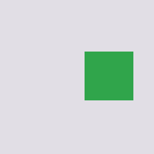

# Neural eDSL

An experimental interface from continuous features to explicit, typed expressions.

The research question is whether neural-derived structure can be translated into claims another system can inspect and use. This work began as the learned decoder within NISP, a robot-decision prototype. Developing that component exposed the distinction between producing a valid expression and establishing that it faithfully describes its input.

The implementation separates learned inference from typed construction. With object roles supplied, the scene experiments test whether properties and their combinations survive translation into a description another component can query:

$$
x\xrightarrow{f_\theta}\widehat{s}\xrightarrow{C}P,
\qquad \mathrm{execute}(P,q)=a.
$$

This v0 contains a recovered mixed-source proxy task with a new lightweight readout, plus two separate scene-language demonstrations: controlled feature mixing and frozen DINOv2 object features. The proxy corpus combines cached TRIBE-derived video features with synthetic robot-fixture inputs. Normal inference uses NumPy; fitted parameters and example inputs are included. Full integration of the learned decoder into NISP remains unfinished.

## Run

```bash
python -m pip install .
neural-edsl proxy --domain scene
```

The bundled recovered input produces `(detect scene (normal))`. The proxy readout predicts one of four expressions: scene normal/anomaly or robot proceed/abort. The CLI returns that expression and its validated fields.

```bash
neural-edsl proxy --input your_proxy_features.npy --domain scene
```

The input is a compatible `(17,16)` pooled proxy array. Its layout is a feature adapter, rather than anatomical regions by time. The domain is a learned feature hint, so the four-class model can still predict a different domain. The [methods](METHODS.md#recovered-proxy-task) explain the source, evaluation and output contract.

## Executable scene programs

The separate scene language describes two objects and supports property selection, counting and spatial order:

```bash
neural-edsl scene --query count shape circle
neural-edsl scene --query left_of a b
neural-edsl image-features --query select color red
```

The controlled `scene` example contains two circles, with a left of b. The image-feature example below uses two rendered object cards whose DINOv2 features were extracted with a frozen encoder. Red circles were excluded from the readout's training and validation data.

| Object a | Object b |
|---|---|
|  |  |

```text
(scene (object a red circle left) (object b green square right))
select color red → [a]
```

```bash
neural-edsl image-features --query count shape circle
neural-edsl image-features --query left_of a b
```

`image-features` accepts a `(2,768)` array of DINOv2 ViT-B/14 reg4 object features. `scene` accepts the controlled benchmark's `(2,32)` representation. Supply `--input example.npy` to use your own compatible features. These front ends demonstrate the richer language separately from the four-target proxy task.

## Use from Python

```python
from neural_edsl import ProxyCompiler, SceneCompiler, execute, render
from neural_edsl.models import example

claim = ProxyCompiler().compile(example("proxy_example.npy"), domain="scene")
print(claim.render())  # (detect scene (normal))

scene = SceneCompiler().compile(example("scene_example.npy"))
print(render(scene))
print(execute(scene, "count", "shape", "circle"))  # 2
```

The scene language's 324 valid meanings have exhaustive compile/render/parse round-trip tests. Its interpreter executes queries over the predicted description. The proxy path returns a validated expression; it does not execute a robot action or invoke Lean. The experiments measure agreement with task labels separately from structural validity.

## Results

| Evaluation | Result |
|---|---|
| Mixed-source proxy features; four-fold grouped tests | Linear front end: **51/68** originals correct (37/53 video, 14/15 robot fixture); sequence model: 42/68 |
| Controlled mixing; unseen color/shape combinations | Semantic grid: **34/34** meanings across three seeds |
| Frozen DINOv2 features of rendered cards; unseen readout combinations and test styles | Validation-selected categorical readout: **136/136** programs across 34 meanings and four style pairs |
| Same DINOv2 task, ordinal scalar-grid alternative | **64/136** programs; familiar-combination test programs remain correct |

These are different tasks. The image experiment supplies object cards and role ordering. Its holdout applies to readout training; the pretrained encoder's earlier exposure is unknown. The proxy score counts 68 originals, with augmented versions kept together. [Methods and reproduction](METHODS.md) describes the protocols and the weaker alternatives.

The practical design question is which intermediate representation makes learned information usable by the receiving program. The [relation to existing work](METHODS.md#relation-to-existing-work) connects the readouts and interpreter to concept bottlenecks and neuro-symbolic scene reasoning.

## Reproduce

```bash
python -m pip install '.[test,experiments]'
python -m pytest -q
python experiments/proxy.py
python experiments/image_features/run_experiment.py --features benchmarks/image_features.npz
```

`experiments/proxy.py` refits the fixed linear and RBF baselines from bundled features; the sequence-model score is a retained recovery result. The bundled image features likewise allow refitting the readouts without loading DINOv2. Re-extracting features uses the separately supplied encoder cache described in [METHODS.md](METHODS.md). Full composition training is also included under `experiments/composition/`.

The controlled and DINO experiments were added during recovery to test composition and executable semantics. They complement the original neural-derived motivation with inspectable software demonstrations. The open research connection is faithful neural-to-symbolic translation into a richer executable language.

Code is available under the [Apache-2.0 license](LICENSE). The
[earlier decoder snapshot](https://github.com/absjaded/neural-edsl-compilerv2/tree/b5ab679db3da437ad1cd2037d735ee48bbd270b8)
remains accessible in Git history.
